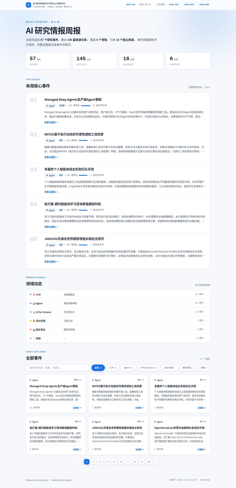
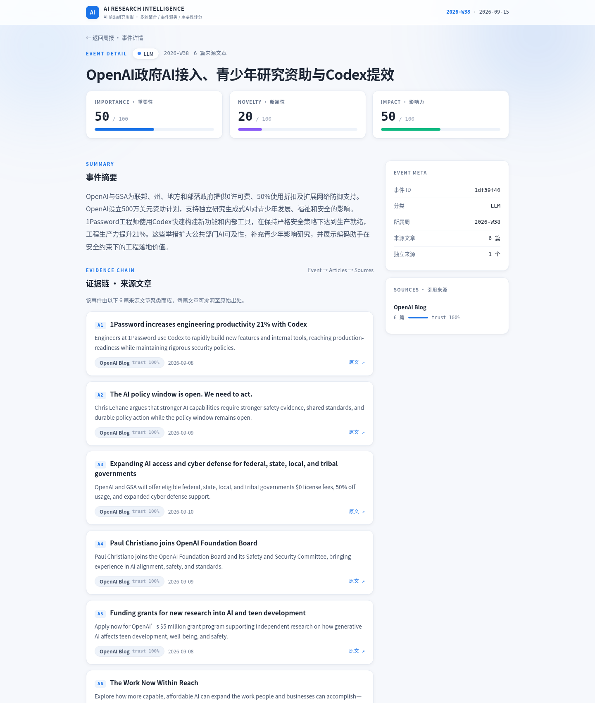
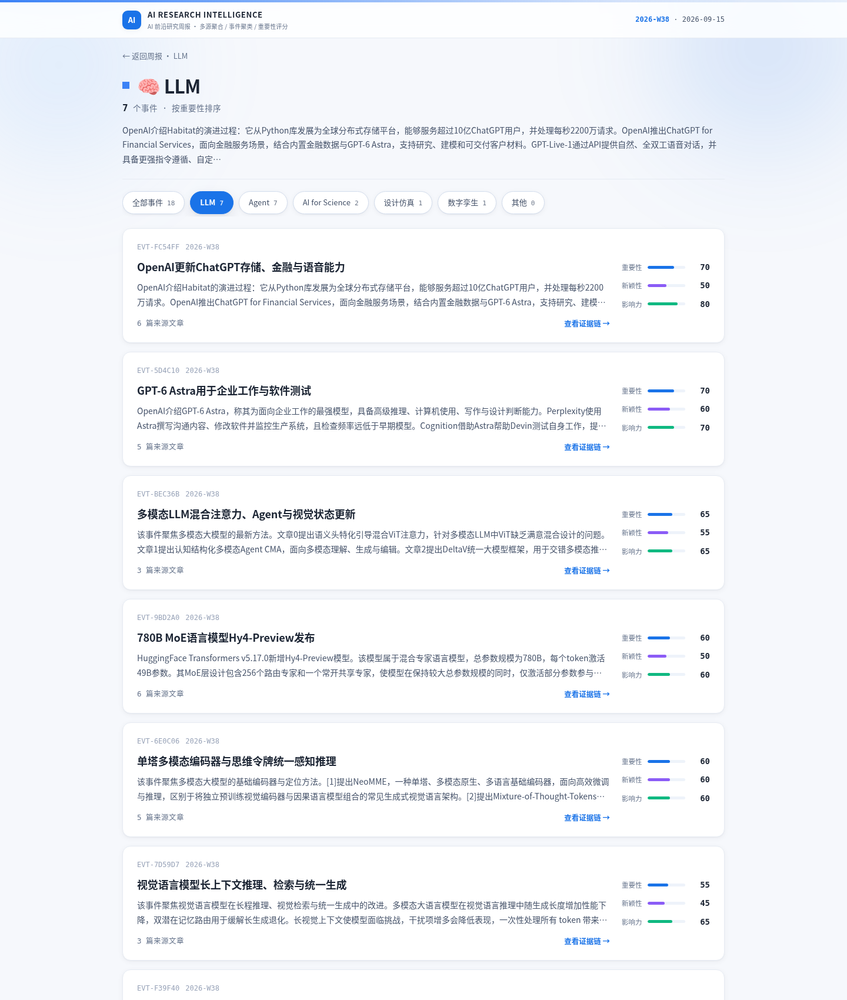

# Weekly AI Report

面向研究与工程读者的 AI 周报流水线：从 RSS、arXiv、GitHub、Exa 等来源获取文章，完成质量审核、语义聚合、评分与有证据支持的研究观察，生成以事件和研究议题为单位的网站。

**[查看 W44 周报](https://loanne-lxy.github.io/weekly-ai-report/2026-W44/)**

## 页面预览

| 首页：核心事件、领域信号、搜索与筛选 | 事件详情：摘要、评分依据、来源证据 | 分类页：领域事件列表 |
|---|---|---|
|  |  |  |

截图用于展示页面布局，不代表最新一期的数据。前端使用 Jinja2、内联 CSS 和原生 JavaScript，无前端框架、外部字体或 CDN 依赖。

## 聚合机制

聚合由两个阶段配合完成：**前期模型生成候选簇，后续大模型策展决定最终分组**。

1. **候选聚类**：多语言向量嵌入；学术文章使用余弦相似度贪心聚类，新闻及社区内容使用 BERTopic（UMAP + HDBSCAN）。
2. **策展与跨簇复核**：审核相关性、拆分混杂内容；通过语义近邻、论文/项目标识和具体研究问题线索召回跨簇候选，进行配对及整组证据复核后合并。

| 分组类型 | 合并依据 | 示例 |
|---|---|---|
| `news_event` | 同一具体发布、合作、研究或项目进展的互补报道 | 论文与配套解读、同一次产品发布的不同来源报道 |
| `research_theme` | 不同工作回答同一个明确、有限的研究问题，逐篇说明贡献 | Agent 记忆检索与持久化、安全门控与运行监控、多机器人协调 |

不同论文可以形成研究议题；同属 Agent、同一公司或笼统地“提升性能”不足以合并。相似度用于召回候选，最终归属还需原文证据与整组审核。单篇事件允许保留，不为降低事件数量而强行合并。

## 处理流程

```text
来源注册表（SQLite；sources.yaml 为初始种子）
  → 多源抓取
  → 正文恢复与清洗、近七天日期窗口检查
  → URL 去重、关键词黑名单
  → 候选聚类
  → 大模型策展：相关性、语义拆分、分类、摘要及评分依据
  → 跨簇匹配与整组复核
  → 证据加权排序、逐篇去向核对、按周保存数据库快照
  → 跨事件研究观察与领域信号
  → 首页、分类页、事件详情页及 JSON 数据
```

常规运行还包含来源评估与发现；历史重放模式跳过 URL 注册表及来源发现/评估的更新。

### 数据质量与排序

- **统一时间窗口**：以 `--cutoff` 为截止时间向前七天；Exa 搜索和文章预处理使用同一报告时钟。历史重放不采用运行当天的日期。
- **预处理**：清理网页噪声，常规运行先尝试恢复过短正文；已知日期超窗、正文不足或缺少文章身份的信息会被排除。未知日期单独标记，不能进入 Top Events。
- **内容审核**：相关性提示词与模型判断决定是否保留，代码校验原文引句、成员覆盖和证据相关性。分类不匹配不能单独作为明确 AI 研究无关的依据。
- **来源与证据分开**：来源质量是出版方参考指标，不能替代文章对当前事件的证据相关性；每个成员需有原文支持，相关性至少为 0.75。
- **可解释评分**：Importance、Novelty、Impact 均为 0–1，附评分理由。技术分权重为 85%，来源质量与新鲜度为 15%，再乘以证据相关性与时间衰减；文章数量不直接提高置信度。
- **可追溯输出**：摘要按“核心突破—解决的问题—研究价值”组织；核心证据优先展示。研究观察引用多个事件，领域信号描述具体进展，并保留证据局限。
- **按周替换**：同一周重跑替换该周事件和关联快照；历史周报保留。不会为填满空领域而把旧文章混入本周。

## 快速开始

推荐 Python 3.11，在 Linux / WSL 环境运行：

```bash
git clone https://github.com/loanne-lxy/weekly-ai-report.git
cd weekly-ai-report
python3 -m venv venv
source venv/bin/activate
pip install -r requirements.txt
cp .env.example .env
```

在 `.env` 中填写模型及所需来源的凭据，在 `config.yaml` 中配置可访问的模型端点。默认使用 OpenAI 兼容接口的 Qwen 模型；`QWEN_API_KEY` 用于模型，`GITHUB_TOKEN`、`EXA_API_KEY` 按来源需求配置。不要提交 `.env`。

```bash
python main.py
```

输出位于 `output/<YEAR>-W<WEEK>/`，包含首页、分类页、`events/*.html`、`articles.json` 和 `research_observations.json`。离线嵌入模式需要事先准备模型缓存；LLM 和在线抓取仍需要相应服务。

### 历史重放与隔离验证

使用保存的原始文章，固定报告周与截止时间；指定独立目录可避免覆盖正式数据库和页面：

```bash
python main.py \
  --from-cache data/runs/2026-W44/raw_articles.json \
  --week 2026-W44 \
  --cutoff 2026-10-26T00:00:01Z \
  --replay \
  --data-dir data/replay-w44 \
  --output-dir output-preview
```

`--replay` 必须与 `--from-cache`、`--week`、`--cutoff` 同时使用。原始文章缓存属于本地运行产物，不随仓库分发；新克隆需先抓取或准备缓存。重放仍可能调用模型，冻结输入并不保证跨模型版本逐字相同。

其他模式：`--baseline` 运行采样基线，`--regression <dir>` 对照已有基线，`--from-cache FILE` 复用原始输入。`--reset` 用于测试时重置去重数据库。

## 验证与文章去向

```bash
python -m unittest tests.test_event_identity tests.test_w44_quality tests.test_article_lineage
python scripts/article_lineage.py data/runs/2026-W44
python scripts/evaluate_event_identity.py --run-dir data/runs/2026-W44
```

逐篇去向工具生成 `article_lineage.json` 和 `article_lineage.md`，记录保留分组、审核状态及排除原因。真实聚合验收样本针对冻结 W44 输入；不是任意新周报的通用精确率评测。

`data/runs/<WEEK>/` 还保存 `raw_articles.json`、`decisions.json`、`curated_events.json` 和 `audit.json`。完整 W44 验收脚本 `scripts/verify_quality_report.py` 检查证据、Top Events、研究观察、链接、历史数据和原错误大簇的去向，需要本地修复前数据库作为 `--baseline`；该历史基线不随仓库分发。

## 主要模块

| 模块 | 职责 |
|---|---|
| `main.py` | 流水线编排、报告时钟、重放与审计 |
| `source_registry.py` / `source_db.py` | 来源注册表与运行状态 |
| `fetcher/` | RSS、arXiv、GitHub、Exa 等抓取与连接器 |
| `filter/quality.py` | 时间窗口、正文清洗与恢复、质量保护 |
| `event_clustering.py` / `embedding_model.py` | 高召回候选聚类、多语言嵌入 |
| `filter/event_curator.py` | 相关性、分组审核、摘要、证据及评分依据 |
| `filter/event_identity.py` | 跨簇候选召回、配对审核及整组复核 |
| `filter/scoring.py` | 证据加权评分、时间衰减与排序 |
| `references/event_curator_*.md` | 策展提示词与分组契约 |
| `article_db.py` | `knowledge.db` 中的文章、事件、关联与周报快照 |
| `generator/research_observations.py` | 有引用校验的跨事件观察与领域信号 |
| `generator/report_generator.py` / `generator/templates/` | 网站生成与页面模板 |
| `scripts/` / `tests/` | 逐篇审计、质量验收与回归测试 |

五个主要领域：LLM、Agent、AI for Science、设计仿真、数字孪生。来源种子见 `sources.yaml`；运行时来源状态保存在 SQLite。模型、黑名单、类别与评估设置见 `config.yaml`。模型客户端当前固定 `temperature=0`；LangSmith 追踪可通过 `LANGSMITH_TRACING=true` 启用。

## 发布到 GitHub Pages

[部署工作流](.github/workflows/deploy.yml) 在 `master` 上的 `output/**` 变更推送后执行，也支持手动触发。先验证生成结果，再提交对应周目录。`output/` 默认被忽略，因此新增产物需要显式加入：

```bash
git add -f output/2026-W44
git commit -m "deploy validated W44 report"
git push origin master
```

工作流上传整个 `output/` 并部署 GitHub Pages。仅更新代码或 README 不会触发页面重新部署。定时任务可调用 `venv/bin/python main.py`；自动发布前应增加验证步骤，避免将生成失败或不完整的周报直接推送。

---

Built during an internship at **TCL Research, Wuhan** · 2026
